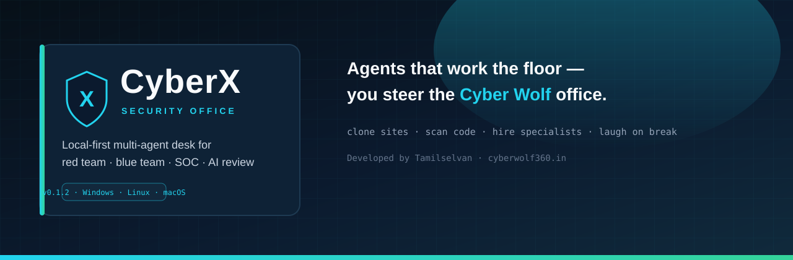
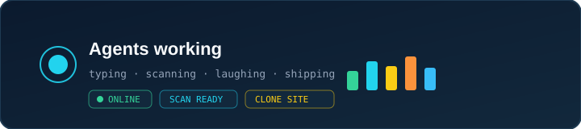
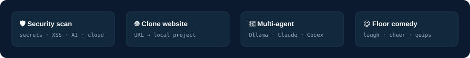
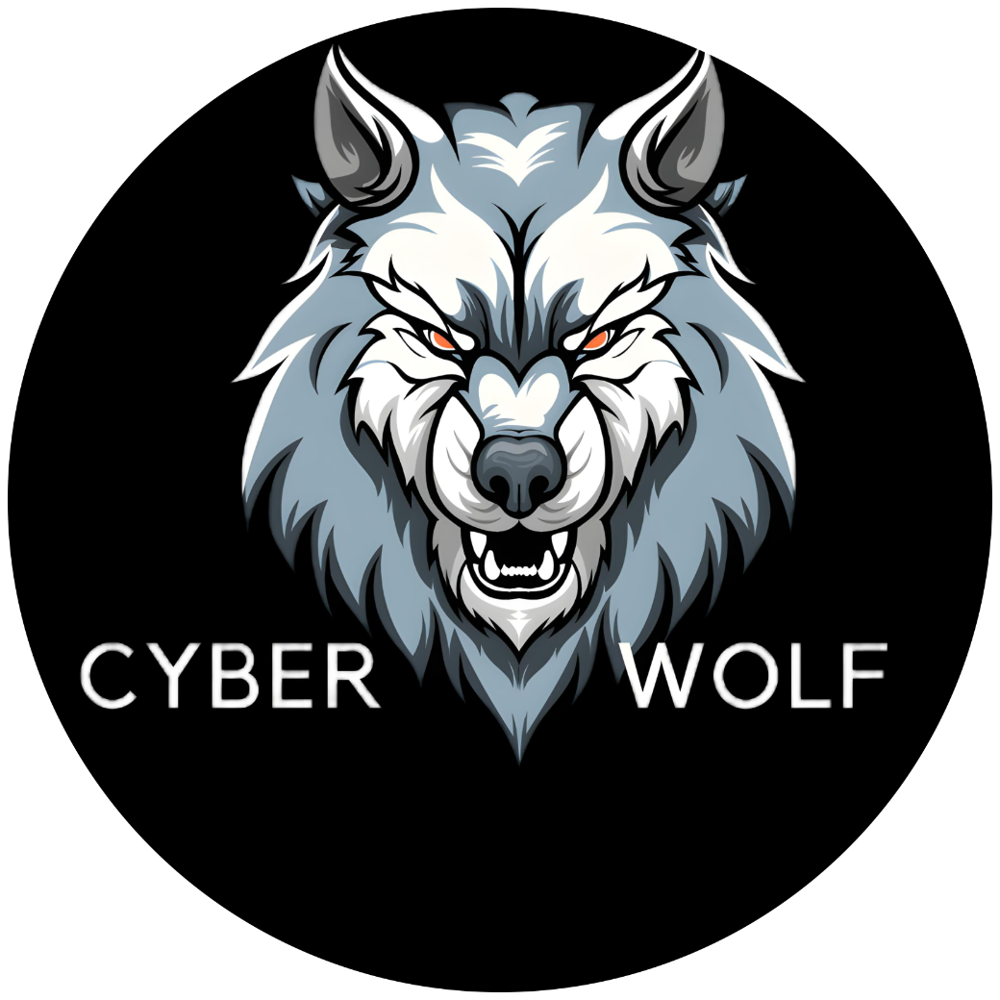

<!--
  CyberX — interactive GitHub README
  Developed by Cyber Wolf / Tamilselvan
  Version 0.1.2
-->

<p align="center">
  
</p>

<p align="center">
  <a href="#32-about-the-developer--cyber-wolf"></a>
</p>

<p align="center">
  
  
  
  
</p>

<p align="center">
  <b>CyberX</b> is a <b>local-first</b> desktop security office.<br />
  Hire agents. Clone websites. Scan code. Steer the floor.<br />
  Built by <a href="https://www.cyberwolf360.in"><b>Cyber Wolf</b></a> · Tamilselvan
</p>

<p align="center">
  <a href="#3-install">Install</a> ·
  <a href="#4-quick-start">Quick start</a> ·
  <a href="#7-website-clone">Clone site</a> ·
  <a href="#8-security-center">Security</a> ·
  <a href="#32-about-the-developer--cyber-wolf">Developer</a>
</p>

<p align="center">
  
</p>

---

# Interactive table of contents

> Click any row. Expand `<details>` blocks below for deep explanations.  
> **Last sections (§31–§36) are dedicated to the developer — Cyber Wolf / Tamilselvan.**

| # | Section | What you learn |
| ---: | --- | --- |
| 1 | [What is CyberX?](#1-what-is-cyberx) | Product definition in plain language |
| 2 | [Why it exists](#2-why-it-exists) | Problem → solution |
| 3 | [Install](#3-install) | Windows / Linux / macOS packages |
| 4 | [Quick start](#4-quick-start) | First 10 minutes |
| 5 | [First-launch tour](#5-first-launch-tour) | Ads, wizard, tutorials |
| 6 | [The office floor](#6-the-office-floor) | Avatars, desks, comedy |
| 7 | [Website clone](#7-website-clone) | URL → local project → scan |
| 8 | [Security center](#8-security-center) | Scanner, API, flows, PDF |
| 9 | [Security skills](#9-security-skills) | 41 built-in skills |
| 10 | [Agents & hiring](#10-agents--hiring) | Roles, briefings, cast |
| 11 | [Models & Ollama](#11-models--ollama) | Manual typing + defaults |
| 12 | [Default orchestrator](#12-default-orchestrator) | God agent settings |
| 13 | [Command Center](#13-command-center) | Terminal, tasks, memory |
| 14 | [Voice](#14-voice) | Dictation into the composer |
| 15 | [IDE features](#15-ide-features) | Palette, menus, shortcuts |
| 16 | [Hive & harness paths](#16-hive--harness-paths) | `cyberwolf/` layout |
| 17 | [Guardrails](#17-guardrails) | Auto mode, budgets, breakers |
| 18 | [Architecture](#18-architecture) | Main / preload / renderer |
| 19 | [Project map](#19-project-map) | Important folders |
| 20 | [IPC surface](#20-ipc-surface-windowcth) | `window.cth` highlights |
| 22 | [Installer pack](#22-installer-pack) | GitHub Releases downloads |
| 23 | [Signing](#23-signing) | Authenticode notes |
| 24 | [Changelog highlights](#24-changelog-highlights) | 0.1.0 → 0.1.2 |
| 25 | [FAQ](#25-faq) | Common questions |
| 26 | [Safety & ethics](#26-safety--ethics) | Authorized testing only |
| 27 | [Troubleshooting](#27-troubleshooting) | Fix common issues |
| 28 | [Keyboard & menus](#28-keyboard--menus) | Electron menu map |
| 29 | [CyberX CLI](#29-cyberx-cli) | Kali / Python scanner |
| 30 | [Roadmap ideas](#30-roadmap-ideas) | Where it can grow |
| 31 | [Contributing](#31-contributing) | How to help |
| **32** | [**About the developer — Cyber Wolf**](#32-about-the-developer--cyber-wolf) | **Who builds this** |
| **33** | [**Developer vision**](#33-developer-vision) | **Why CyberX was made** |
| **34** | [**Developer contact & links**](#34-developer-contact--links) | **Site · GitHub · brand** |
| **35** | [**Acknowledgments**](#35-acknowledgments) | **Libraries & inspiration** |
| **36** | [**License & notice**](#36-license--notice) | **Closing** |

<p align="center">
  
</p>

---

## 1. What is CyberX?

**CyberX** is an Electron desktop app that looks like a **pixel security office**.  
Each agent is a character on the floor. Each agent runs a real CLI AI (Claude Code, Codex, OpenCode, Crush, pi, Gemini/agy, Cursor, …) inside a project folder you choose.

You do not “chat with a website.” You **hire a team**, give them a folder, and send work orders. The floor shows who is typing, blocked, celebrating, or laughing on break.

<details>
<summary><b>Plain-language definition (expand)</b></summary>

<br />

| Phrase | Meaning |
| --- | --- |
| Local-first | Agents and files stay on your PC; you bring the model keys / Ollama |
| Security office | Built-in scanner, skills, clone, pentest-oriented cast |
| Multi-agent | Many PTYs + hive mail + orchestrator (“god”) agent |
| Cyber Wolf | The organization / brand that develops CyberX |

</details>

---

## 2. Why it exists

Security work is messy: clone a site, hunt secrets, write a report, assign follow-ups.  
Chat UIs forget context. IDEs do not show a living team. Cloud agents leave your code off-box.

CyberX answers: **keep the work local, make the team visible, ship security tooling in the same window.**

<details>
<summary><b>Problem → CyberX answer</b></summary>

<br />

| Problem | CyberX answer |
| --- | --- |
| “I need many specialists” | Hire red team, SOC, CISO, … with briefings |
| “I need the website offline” | Clone URL into `~/CyberX-clones` |
| “I need findings, not vibes” | Scanner + PDF + skills |
| “I want local models” | Ollama / custom model typing |
| “I want it fun” | Floor comedy, cheer, laugh FX |

</details>

---

## 3. Install

Download release builds from GitHub. Current Windows package: **0.1.2**.

| OS | Download | Notes |
| --- | --- | --- |
| **Windows** | [CyberX-0.1.2-win-x64-setup.exe](https://github.com/Tamilselvan-S-Cyber-Security/Cyber-X/releases/download/CyberX/CyberX-0.1.2-win-x64-setup.exe) | Setup installer (recommended) |
| **Linux** | [CyberX-0.1.0-linux-x64.tar.gz](https://github.com/Tamilselvan-S-Cyber-Security/Cyber-X/releases/download/CyberX/CyberX-0.1.0-linux-x64.tar.gz) | Unpack on Linux |
| macOS | Build on a Mac / CI (`npm run dist:mac`) | Place DMG under `CyberX-installer/macos/` |

<p align="center">
  <a href="https://github.com/Tamilselvan-S-Cyber-Security/Cyber-X/releases/download/CyberX/CyberX-0.1.2-win-x64-setup.exe">
    
  </a>
  &nbsp;
  <a href="https://github.com/Tamilselvan-S-Cyber-Security/Cyber-X/releases/download/CyberX/CyberX-0.1.0-linux-x64.tar.gz">
    
  </a>
</p>

<details>
<summary><b>Windows install steps</b></summary>

<br />

1. Download [CyberX-0.1.2-win-x64-setup.exe](https://github.com/Tamilselvan-S-Cyber-Security/Cyber-X/releases/download/CyberX/CyberX-0.1.2-win-x64-setup.exe).
2. Run the installer and choose a folder if asked.
3. Finish — CyberX can launch automatically.
4. If SmartScreen appears on an unsigned build, see [§23 Signing](#23-signing).

</details>

<details>
<summary><b>Linux install steps</b></summary>

<br />

1. Download [CyberX-0.1.0-linux-x64.tar.gz](https://github.com/Tamilselvan-S-Cyber-Security/Cyber-X/releases/download/CyberX/CyberX-0.1.0-linux-x64.tar.gz).
2. Unpack and install:

```bash
# from the repo (or copy install-linux.sh next to the archive)
bash CyberX-installer/linux/install-linux.sh /path/to/CyberX-0.1.0-linux-x64.tar.gz
```

</details>

<details>
<summary><b>macOS install steps</b></summary>

<br />

```bash
# on a Mac after dist:mac / CI artifact
bash CyberX-installer/macos/install-macos.sh path/to/CyberX-*-mac-universal.dmg
```

</details>

---

## 4. Quick start

1. Launch CyberX → pick / create harness home (default **`~/CyberWolf`**).
2. Register a **project folder** (or [clone a website](#7-website-clone)).
3. **Add Agent** → pick cast, engine, model (type an Ollama tag if needed).
4. Click the agent on the floor → write a task → send.
5. Open **Security** to scan, or **Skills** to install security packs.

<details>
<summary><b>10-minute checklist</b></summary>

<br />

- [ ] Home folder created  
- [ ] At least one project registered  
- [ ] One worker agent hired  
- [ ] One prompt sent and answered  
- [ ] Security scan run (optional)  
- [ ] One security skill installed (optional)  

</details>

---

## 5. First-launch tour

On first open you may see:

1. **Ads / intro video** (`ads.mp4`) — skippable after a short delay  
2. **Cyber Wolf typing banner** — brand presence  
3. **Onboarding wizard** — audience, home, default engine (local-friendly defaults)  
4. **Feature tutorials** — terminals, memory, guardrails  

<details>
<summary><b>Why the video / banner exist</b></summary>

<br />

They introduce **Cyber Wolf** branding and set the tone of a security product office — not a generic chatbot skin. You can dismiss and continue working.

</details>

---

## 6. The office floor

The floor is a Pixi.js scene: desks, paths, thought bubbles, status glyphs.

| Status | What you see |
| --- | --- |
| Working | Seated, typing animation, live action bubble |
| Thinking | Seated, reading pose |
| Blocked | Warning glyph — needs you |
| Success / idle | Wander, cheer after long tasks |
| Comedy | Occasional **laugh** FX + floor comedy toast |

<details>
<summary><b>Comedy & motion (expand)</b></summary>

<br />

- **Cheer** — hops + confetti after meaningful finished work  
- **Laugh** — shoulder shake + “ha” particles; idle / gossip / post-cheer  
- **Thought bubbles** — pop-in scale animation  
- **Task complete popup** — card with funny subtitle  
- **Floor comedy popup** — bottom-right toast when someone cracks up  

Files of interest: `src/renderer/src/scene/office/Character.ts`, `OfficeFloor.tsx`, `ComedyMomentPopup.tsx`.

</details>

---

## 7. Website clone

Clone a **public** site into a local folder for offline review and scanning.

**Where**

- Title bar → **Security** → tab **Clone website**  
- **Add Agent** → Workspace → **Clone website from URL**

**What happens**

```text
https://example.com
        │
        ▼
 ~/CyberX-clones/<host>-<timestamp>/
        │
        ├─ HTML / CSS / JS / assets (bounded crawl)
        ├─ CYBERX-CLONE.md
        └─ auto-registered in Settings projects
                │
                ▼
        Security Scanner / hire agent on that folder
```

<details>
<summary><b>Controls & safety</b></summary>

<br />

| Control | Default | Meaning |
| --- | --- | --- |
| Depth | 2 | Link hops from the start page |
| Max pages | 40 | Cap on HTML pages |
| Same-origin | on | Do not crawl other hosts as pages (CDN assets still pulled) |
| SSRF guard | always | Blocks localhost / private / link-local / metadata hosts |

**Only clone sites you own or are authorized to test.**

Implementation: `src/main/siteImport.ts` · IPC `site:import` · `window.cth.siteImport(...)`.

</details>

---

## 8. Security center

Full-screen **Security** panel tabs:

| Tab | Purpose |
| --- | --- |
| Scanner | Static heuristics across the registered project |
| API surface | Route discovery + auth signals |
| Checks | Enable / disable individual rules |
| Clone website | Import from URL |
| Flow builder | Graph of scan → filter → report → agent |

<details>
<summary><b>Scanner categories (expand)</b></summary>

<br />

Secrets · API · Injection · XSS · Crypto · Auth · Config · Network · Cloud · CI/CD · Deps · Mobile · AI/LLM · Web3 · Logging · Files  

**Extra web/clone-oriented checks (0.1.2):** mixed content, HTTP form actions, inline handlers, `postMessage('*')`, localStorage tokens, scripts without SRI, open-redirect params, CORS `*` + credentials.

</details>

<details>
<summary><b>Reports</b></summary>

<br />

- Markdown report into the project  
- **PDF** export (sandboxed BrowserWindow, JS off)  
- Send findings to an agent as a structured brief  

</details>

---

## 9. Security skills

**Command Center → Skills → Security**

One-click install writes Claude Code `SKILL.md` files (user or project scope).

<details>
<summary><b>Categories & examples</b></summary>

<br />

| Category | Examples |
| --- | --- |
| Recon & search | CVE search, attack surface, secrets hunt, SCA |
| Code review | OWASP Top 10, injection, XSS/CSRF, crypto |
| Cloud & infra | IaC, containers, CI/CD, IAM |
| Detection & response | Sigma, YARA, IR runbook, MITRE, STRIDE |
| AI security | LLM Top 10, tool abuse, RAG leakage, supply chain |
| AppSec & web | ASVS, CORS/CSP, uploads, GraphQL, WebSocket, **cloned site review** |
| Identity & access | OAuth/OIDC, RBAC, MFA, service accounts |
| Reporting | Pentest report writer, hardening checklist |

Catalog: `src/shared/securitySkills.ts` (~**41** skills).

</details>

---

## 10. Agents & hiring

**Add Agent** sections: Identity · Workspace · Engine · Briefing.

<details>
<summary><b>Security cast roles</b></summary>

<br />

Red team · white hat · pentester · bug hunter · exploit developer · social engineer · OSINT · blue team · SOC · purple team · threat hunter · IR · forensics · malware analyst · CISO — with one-click **SECURITY_BRIEFINGS**.

</details>

<details>
<summary><b>Edit agent</b></summary>

<br />

Change provider/model (including OSS chips + custom field). Same AI can resume; different AI restarts the session on the new engine.

</details>

---

## 11. Models & Ollama

Type any model id. For OSS engines:

| Engine | Bare tag becomes |
| --- | --- |
| OpenCode | `local/<tag>` |
| Crush / pi | `ollama/<tag>` |

<details>
<summary><b>Where to type</b></summary>

<br />

- Add Agent → Model → **Custom / Ollama** field  
- Edit Agent → same  
- Settings → default Claude model field  
- Settings → Default orchestrator  
- Settings → AI Engines → per-CLI default model placeholders  

Component: `CustomModelField.tsx` · picks: `ossModels.ts`.

</details>

---

## 12. Default orchestrator

**Settings → Agents & Models → Default orchestrator (God agent)**

Sets `godProvider` + `godModel` used when the lead agent boots. Includes engine chips, model chips, OSS picks, and manual typing.

---

## 13. Command Center

Select an agent → Command Center tabs typically include Terminal, Floor/activity, Memory, Tasks, Skills, Triggers, Handbook (exact set evolves with version).

<details>
<summary><b>Work orders</b></summary>

<br />

Messages enqueue to the agent PTY / hive inbox. Long tasks can show **Task complete** popup + speech (if enabled).

</details>

---

## 14. Voice

| Action | Result |
| --- | --- |
| Click **voice** | Listening |
| Click again | Transcript → message box |
| Groq / xAI key | Transcription backend in Settings |

Mic is opt-in. Free Flow / Realtime features follow Settings permissions.

---

## 15. IDE features

VS Code–style touches: command palette, shortcuts, folder open, Monaco editor surfaces, Electron menus (File / Edit / Selection / View / Go / Run / Terminal / Help).

**Run → Open Security Panel** opens the security overlay.

---

## 16. Hive & harness paths

Under your harness home (default `~/CyberWolf`):

```text
<home>/
  cyberwolf/        agent hive (migrated from hive/)
  cyberwolf.json    roster mirror (migrated from roster.json)
  cw-backup/        roster backups
  palace/           MemPalace data
```

Migration runs on open — legacy names rename when safe. See `src/main/harnessPaths.ts`.

---

## 17. Guardrails

| Control | Role |
| --- | --- |
| Auto mode | Skip / ask permissions for agent tools |
| Max turns | Cap agent loops |
| Cost / token budgets | Circuit breaker fields in Settings |
| Registered repos | Scanner + skills allowlist |

---

## 18. Architecture

```text
┌──────────────────────── Renderer (React + Pixi) ────────────────────────┐
│  OfficeFloor · Command Center · SecurityPanel · Settings · Modals       │
└───────────────────────────────┬─────────────────────────────────────────┘
                                │ window.cth (preload bridge)
┌───────────────────────────────▼─────────────────────────────────────────┐
│  Main: PtyManager · hive · hooks · securityScanner · siteImport · fs/git │
└───────────────────────────────┬─────────────────────────────────────────┘
                                │
                    claude / agy / codex / opencode / …
```

Full contributor map: [`docs/ARCHITECTURE.md`](docs/ARCHITECTURE.md).

---

## 19. Project map

```text
src/main/           Electron main (IPC, PTY, hive, scan, clone)
src/preload/        contextBridge → window.cth
src/renderer/       React UI + Pixi office
src/shared/         securityScan, securitySkills, ossModels, …
CyberX-installer/   OS installers
cyberx-cli/         Python CLI scanner for Kali-style workflows
svg/        README SVGs (banner, working, badges)
build/              icons, signing notes, release-notes
```

---

## 20. IPC surface (`window.cth`)

Highlights (not exhaustive):

| Call | Purpose |
| --- | --- |
| `siteImport` | Clone website → register project |
| `securityScan` | Static scan |
| `securityExportPdf` | PDF report |
| `skillsInstallSecurity` | Install built-in skills |
| `spawnPty` / `pty:*` | Agent terminals |
| `updateConfig` / `getConfig` | Harness settings |
| `chooseFolder` | Workspace picker |

Typed in `src/preload/index.ts`.

---

## 22. Installer pack

Release downloads (primary):

- Windows: https://github.com/Tamilselvan-S-Cyber-Security/Cyber-X/releases/download/CyberX/CyberX-0.1.2-win-x64-setup.exe
- Linux: https://github.com/Tamilselvan-S-Cyber-Security/Cyber-X/releases/download/CyberX/CyberX-0.1.0-linux-x64.tar.gz

Local pack folder (optional): [`CyberX-installer/README.md`](CyberX-installer/README.md).

---

## 23. Signing

Unsigned Windows builds may trigger SmartScreen.  
Paid OV/EV Authenticode + `CSC_LINK` / `CSC_KEY_PASSWORD` — guide: [`build/SIGNING.md`](build/SIGNING.md).

---

## 24. Changelog highlights

| Version | Themes |
| --- | --- |
| **0.1.2** | Ollama typing, default orchestrator, laugh/comedy, website clone, more skills/checks, cyberwolf paths |
| **0.1.1** | Installer pack, Cyber Wolf branding, IDE/menus |
| **0.1.0** | Security panel, cast, PDF, CLI |

Full notes: [`CHANGELOG.md`](CHANGELOG.md).

---

## 25. FAQ

<details>
<summary><b>Does CyberX need the cloud?</b></summary>

<br />

No. The app is local-first. You may use cloud model APIs or local Ollama — your choice.

</details>

<details>
<summary><b>Where do cloned sites go?</b></summary>

<br />

`~/CyberX-clones/<hostname>-<timestamp>/` and they are registered as projects.

</details>

<details>
<summary><b>Can I use Ollama?</b></summary>

<br />

Yes. Use OpenCode / Crush / pi engines and type the tag (e.g. `llama3.2:latest`). Bare tags auto-prefix.

</details>

<details>
<summary><b>Is the scanner a pentest proof?</b></summary>

<br />

No. Findings are **leads**. Confirm in code. Skills and agents help verify safely.

</details>

<details>
<summary><b>Who develops CyberX?</b></summary>

<br />

**Cyber Wolf** / Tamilselvan — see [§32](#32-about-the-developer--cyber-wolf).

</details>

---

## 26. Safety & ethics

- Test only systems you **own** or have **written authorization** to test.  
- Prefer read-only analysis; no destructive DoS or exfiltration.  
- Never paste live secrets into tickets — redact.  
- Website clone is for authorized review, not abuse.

Security skills embed the same guardrails in every `SKILL.md`.

---

## 27. Troubleshooting

| Symptom | Try |
| --- | --- |
| Agent won’t start | Check engine installed / PATH; Settings → Prerequisites |
| Scan refused | Folder must be in **registered projects** |
| Clone fails | HTTPS URL? Not localhost? Network OK? |
| SmartScreen | Expected if unsigned — [§23](#23-signing) |
| Dist folder locked | Build to `dist-win-012` style output dir |

---

## 28. Keyboard & menus

Electron app menu mirrors IDE habits: File, Edit, Selection, View, Go, Run, Terminal, Help.  
**Run** opens Security. Palette / shortcuts live in the IDE panel prefs.

---

## 29. CyberX CLI

Python toolkit under `cyberx-cli/` for Kali / WSL style scanning with shared rule ideas. See `cyberx-cli/README.md`.

---

## 30. Roadmap ideas

- Signed Windows releases by default  
- Deeper DAST (still authorized-only)  
- Richer macOS notarized CI artifacts  
- More floor animations & tutorials  

*(Ideas — not commitments.)*

---

## 31. Contributing

1. Read [`docs/ARCHITECTURE.md`](docs/ARCHITECTURE.md) and [`docs/DESIGN.md`](docs/DESIGN.md).  
2. Keep changes scoped; match existing patterns.  
3. Run `npm run typecheck`.  
4. Do not commit secrets or large binaries unless intentional (installers live in `CyberX-installer/`).

---

# Developer sections

> Everything below is about **who builds CyberX** and how to credit the work.

<p align="center">
  
  &nbsp;&nbsp;&nbsp;
  
</p>

---

## 32. About the developer — Cyber Wolf

**CyberX** is developed by **Cyber Wolf**, led by **Tamilselvan**.

Cyber Wolf focuses on **cybersecurity products**, software services, and practical tools that stay under the user’s control. CyberX is the desktop expression of that idea: a security office you can see, steer, and keep on your own disk.

<details>
<summary><b>Developer identity card</b></summary>

<br />

| Field | Value |
| --- | --- |
| Organization | **Cyber Wolf** |
| Product | **CyberX** |
| Developer | **Tamilselvan** |
| Website | [https://www.cyberwolf360.in](https://www.cyberwolf360.in) |
| Repository | [Tamilselvan-S-Cyber-Security/CyberX](https://github.com/Tamilselvan-S-Cyber-Security/CyberX) |
| App id | `com.tamilselvan.cyberx` |
| Current version | **0.1.2** |

</details>

<details>
<summary><b>What “Cyber Wolf” means in the product</b></summary>

<br />

- Brand voice in onboarding / typing banners  
- Default harness home `~/CyberWolf`  
- On-disk hive layout `cyberwolf/` + `cyberwolf.json`  
- Installer pack messaging and release notes  
- Security-first cast and office metaphor  

</details>

---

## 33. Developer vision

Tamilselvan / Cyber Wolf built CyberX so security work can feel like **running a floor**, not babysitting a single chat thread.

<details>
<summary><b>Vision pillars (expand)</b></summary>

<br />

1. **Local-first** — your projects, your keys, your Ollama, your machine.  
2. **Visible agents** — status on the floor beats hidden background jobs.  
3. **Security-native** — scanner, skills, clone, reports in the same app.  
4. **Human tone** — cheer, laugh, quips — serious tools can still feel alive.  
5. **Honest craft** — unsigned builds warn; signing docs are included; findings are leads, not magic.

</details>

<details>
<summary><b>Design principles the developer follows</b></summary>

<br />

- Prefer clear IPC boundaries (`window.cth`) over leaking Node into the UI.  
- Prefer registered-folder allowlists for scan/write.  
- Prefer bounded crawls and SSRF guards for site import.  
- Prefer installable skills over opaque “do everything” prompts.  
- Prefer changelog + release-notes that a human can scan in a toast.

</details>

---

## 34. Developer contact & links

| Link | URL |
| --- | --- |
| Cyber Wolf site | https://www.cyberwolf360.in |
| CyberX GitHub | https://github.com/Tamilselvan-S-Cyber-Security/Cyber-X |
| Brand assets | `docs/cyberx-logo.png`, `docs/cyberx-mark.png`, `docs/cyberwolf.png` |
| README art | [`svg/`](svg/) folder (banner, working, features, badge) |
| Signing guide | [`build/SIGNING.md`](build/SIGNING.md) |
| Architecture | [`docs/ARCHITECTURE.md`](docs/ARCHITECTURE.md) |

<details>
<summary><b>How to credit CyberX in your write-up</b></summary>

<br />

Suggested line:

> CyberX — local-first multi-agent security office. Developed by Cyber Wolf / Tamilselvan. https://www.cyberwolf360.in

</details>

<details>
<summary><b>Brand kit reminder</b></summary>

<br />

Generate/refresh icons from the logo pipeline:

```bash
node tools/make-cyberx-logo.cjs
```

Outputs splash/mark/icons under `docs/` and `build/`.

</details>

---

## 35. Acknowledgments

CyberX stands on open tools and ecosystems:

- Electron · electron-vite · electron-builder  
- React · PixiJS · xterm · Monaco  
- node-pty · better-sqlite3  
- Claude Code / Codex / OpenCode / Crush / pi and other CLI agents you connect  
- Ollama and local model runners  
- OWASP / CWE references used in scanner & skills copy  

Community installers, bug reports, and skill ideas are welcome through the GitHub repo.

---

## 36. License & notice

Check the repository for the license file applicable to your clone.  
Copyright © 2026 **Tamilselvan** / **Cyber Wolf**.  
Product name **CyberX**. Homepage https://www.cyberwolf360.in.

---

<p align="center">
  
</p>

<p align="center">
  <b>CyberX</b> v0.1.2<br />
  Developed with care by <b>Cyber Wolf</b> · Tamilselvan<br />
  <sub>Local-first · Your disk · Your agents · Your office</sub>
</p>
<p align="center">
  <a href="#interactive-table-of-contents">↑ Back to interactive TOC</a>
</p>

